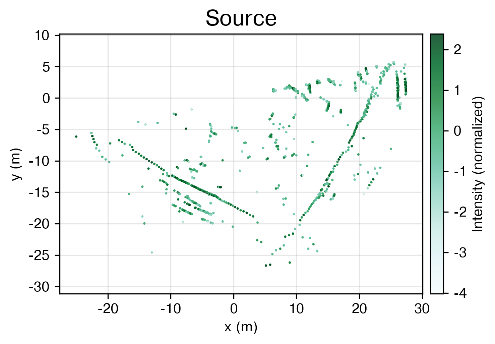
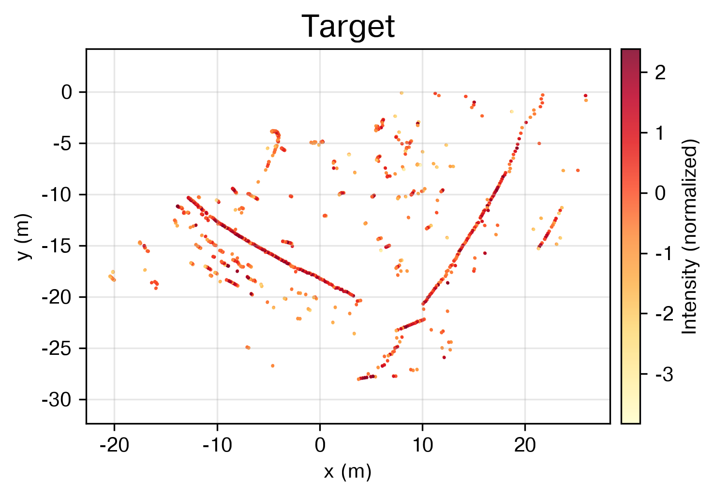
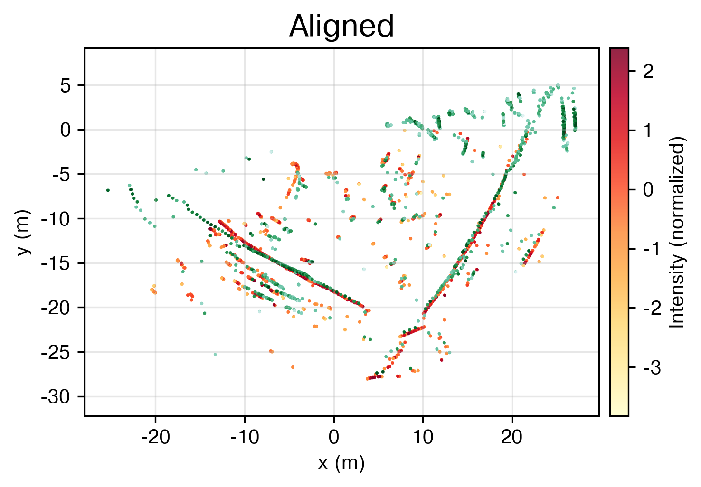

**Problem** Underwater navigation remains an open research question.
The harsh underwater environment limits conventional sensing for SLAM; vision systems (camera, lidar) may be limited by turbidity and overall illumination, GPS and radar are unavailable due to electromagnetic attenuation.
This makes sonar, an active acoustic sensor, the most common and important sensing modality for robust underwater navigation.

**My thesis** investigated the applicability of using a single-beam imaging sonar for underwater SLAM.
While my work was cut short by time, I developed a sonar accumulation framework to create 'scans' from single sonar beams and used ICP for relative pose estimation between scans.

*A pan is an accumulation of sonar beams over a panning motion of the ROV.*
| Source pan — `t₀` (green) | Target pan — `t₁` (orange) | Ground-truth aligned |
|:---:|:---:|:---:|
|  |  |  |